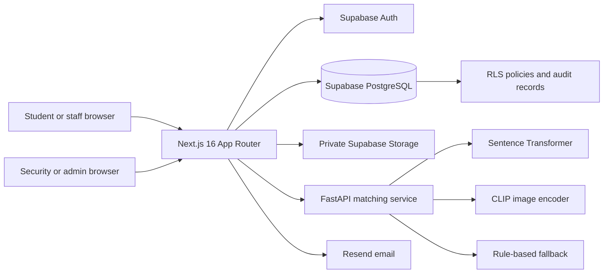
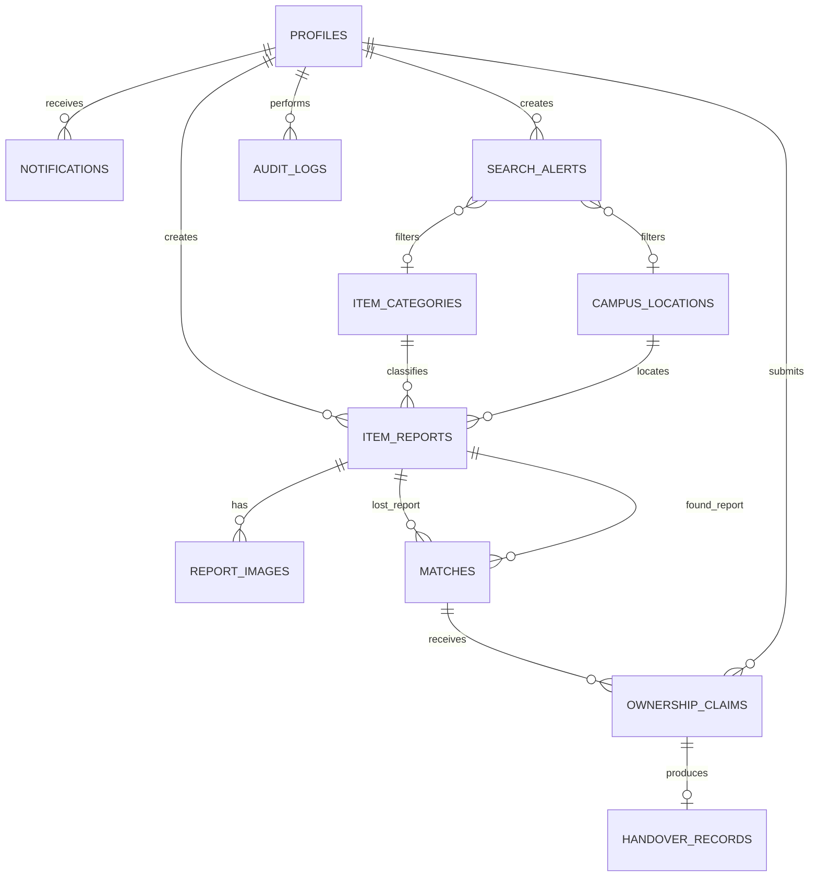
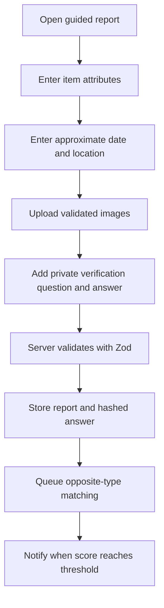
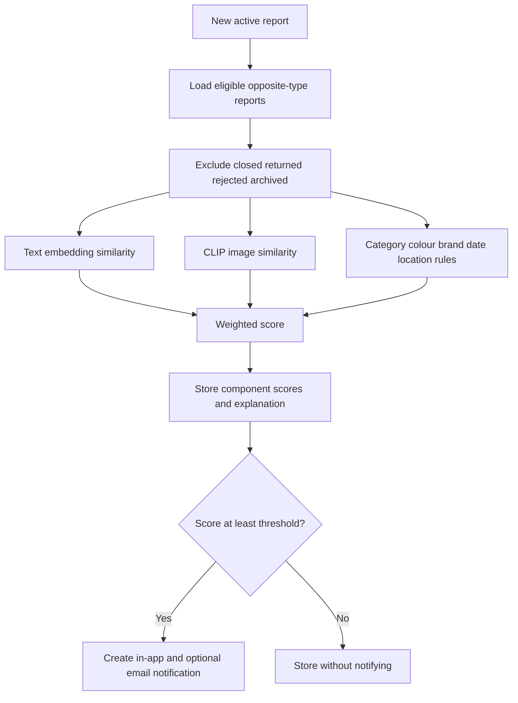
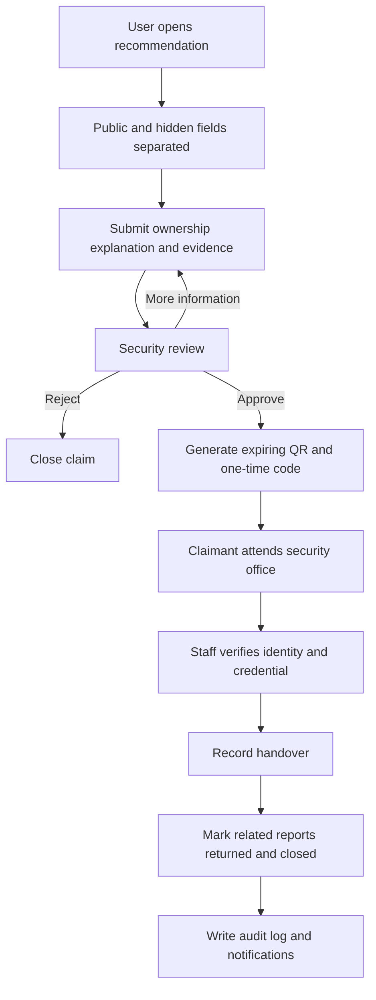

# CampusFind AI architecture and delivery plan

## 1. Concise system overview

CampusFind AI is a role-based university lost-and-found platform. Students and staff submit structured lost or found reports. A separate FastAPI service creates component similarity scores from text, images and structured attributes. The Next.js application stores recommendations, presents privacy-safe summaries, accepts ownership claims and supports staff-controlled QR or one-time-code handovers. Supabase provides PostgreSQL, authentication, private image storage and row-level security.

The AI layer is advisory. It never proves ownership. Final decisions require hidden identifying evidence, campus-security review and a valid collection credential.

## 2. Proposed system architecture



### Trust boundaries

- Browser code receives only the Supabase publishable key.
- Server-only credentials remain in Vercel or deployment environment variables.
- The AI service requires a shared API key and does not receive verification answers.
- Private Storage objects are protected by owner-folder and staff policies.
- Every sensitive mutation is re-authorised in the route handler or database policy; Proxy is not treated as the only security control.

## 3. Complete repository structure

```text
campusfind-ai/
├─ src/
│  ├─ app/
│  │  ├─ api/
│  │  │  ├─ reports/route.ts
│  │  │  ├─ alerts/route.ts
│  │  │  ├─ matches/route.ts
│  │  │  ├─ claims/route.ts
│  │  │  ├─ notifications/route.ts
│  │  │  ├─ handovers/create/route.ts
│  │  │  ├─ handovers/verify/route.ts
│  │  │  └─ admin/export/route.ts
│  │  ├─ admin/...
│  │  ├─ security/...
│  │  ├─ dashboard/...
│  │  ├─ report/lost/...
│  │  ├─ report/found/...
│  │  ├─ reports/...
│  │  ├─ matches/...
│  │  ├─ claims/...
│  │  ├─ notifications/...
│  │  ├─ alerts/...
│  │  ├─ profile/...
│  │  ├─ settings/...
│  │  ├─ auth/callback/route.ts
│  │  ├─ globals.css
│  │  ├─ layout.tsx
│  │  └─ page.tsx
│  ├─ components/
│  │  ├─ admin-charts.tsx
│  │  ├─ auth-form.tsx
│  │  ├─ dashboard-shell.tsx
│  │  ├─ item-card.tsx
│  │  ├─ match-card.tsx
│  │  ├─ report-form.tsx
│  │  ├─ search-alerts-manager.tsx
│  │  ├─ notifications-list.tsx
│  │  └─ shared layout components
│  ├─ lib/
│  │  ├─ supabase/client.ts
│  │  ├─ supabase/server.ts
│  │  ├─ supabase/admin.ts
│  │  ├─ matching.ts
│  │  ├─ schemas.ts
│  │  ├─ repository.ts
│  │  ├─ security.ts
│  │  ├─ telegram-import.ts
│  │  └─ notifications.ts
│  └─ types/domain.ts
├─ supabase/migrations/
│  ├─ 001_schema.sql
│  ├─ 002_seed_demo.sql
│  ├─ 003_search_alerts.sql
│  └─ 004_security_hardening.sql
├─ ai-service/
│  ├─ app/
│  │  ├─ main.py
│  │  ├─ models.py
│  │  ├─ matching.py
│  │  ├─ fallback.py
│  │  └─ embeddings.py
│  ├─ tests/test_matching.py
│  ├─ requirements.txt
│  ├─ requirements-lite.txt
│  └─ Dockerfile
├─ tests/
├─ docs/architecture.md
├─ proxy.ts
├─ package.json
└─ README.md
```

## 4. Database relationship summary



Important privacy choices:

- `verification_answer_hash`, `qr_token_hash` and `verification_code_hash` store hashes, not recoverable plain text.
- `internal_storage_location` is not included in the public view.
- `public_item_reports` returns a restricted description for sensitive items.
- Claims and handover records are limited to the claimant and authorised staff.

## 5. API endpoint list

| Method | Endpoint | Purpose | Access |
|---|---|---|---|
| GET | `/api/reports` | Search privacy-safe summaries | Public/authenticated |
| POST | `/api/reports` | Validate and create a report | Authenticated user |
| POST | `/api/matches` | Calculate transparent weighted score | Server/demo |
| POST | `/api/claims` | Submit ownership evidence | Authenticated user |
| GET | `/api/alerts` | Read saved report alerts | Authenticated user |
| POST | `/api/alerts` | Create a saved report alert | Authenticated user |
| DELETE | `/api/alerts` | Delete a saved report alert | Authenticated user |
| GET | `/api/notifications` | Read own notifications | Authenticated user |
| PATCH | `/api/notifications` | Mark own notifications as read | Authenticated user |
| POST | `/api/handovers/create` | Create signed QR credential | Security/admin |
| POST | `/api/handovers/verify` | Validate QR or one-time code | Security/admin |
| GET | `/api/admin/export` | Export report data as CSV | Admin |
| GET | `/auth/callback` | Exchange Supabase auth code | Public callback |
| GET | `AI /health` | Service health | Internal |
| POST | `AI /v1/score` | Score supplied components | Internal API key |
| POST | `AI /v1/compare` | Calculate report similarities and score | Internal API key |
| POST | `AI /v1/image-similarity` | Compare two images using CLIP | Internal API key |

Handover and admin export handlers perform explicit route-level role checks. Database RLS remains the final enforcement layer.

## 6. Development plan

### Phase 1 — platform foundation

- Create App Router project and design system.
- Configure Supabase browser/server clients and session-refresh Proxy.
- Apply schema, constraints, indexes, profile trigger and RLS.
- Verify role boundaries with policy tests.

### Phase 2 — reporting and discovery

- Complete guided lost/found form.
- Upload validated images to private Storage paths.
- Add search, filters, saved alerts, report timeline, automatic draft recovery and Telegram-post import.
- Trigger matching jobs after active report creation.

### Phase 3 — AI matching and notifications

- Deploy FastAPI in fallback mode first.
- Enable Sentence Transformer and CLIP after memory/latency testing.
- Persist component scores and explanations.
- Notify only above the configured threshold.
- Record administrator correct/incorrect feedback.

### Phase 4 — claims and handover

- Add private evidence upload and staff review workflow.
- Generate signed, expiring credentials.
- Verify claimant identity and credential state at collection.
- Close both reports atomically and write audit events.

### Phase 5 — administration and analytics

- Add user, role, category, location and report management.
- Add recovery, matching and workload charts.
- Export CSV/PDF through authorised server routes.
- Add abuse reporting and account suspension.

### Phase 6 — assurance and deployment

- Run unit, integration, RLS, role, upload, accessibility and responsive tests.
- Add production rate limiting backed by Redis or the deployment platform.
- Add malware scanning or quarantine for uploaded files.
- Configure Vercel, Supabase, Render/Railway and Resend secrets.
- Conduct privacy, threat-model and incident-response reviews.

## Lost-item reporting flow



## AI matching flow



## Ownership claim and collection flow


